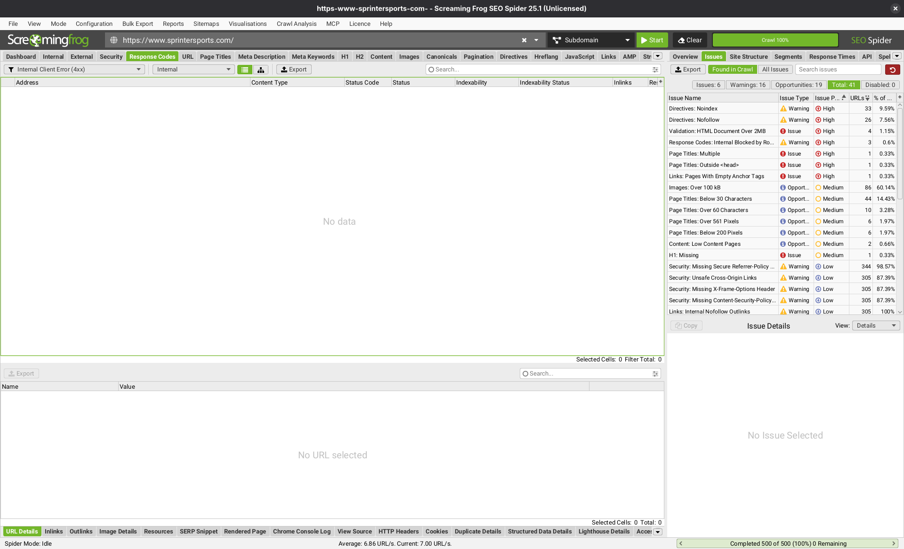
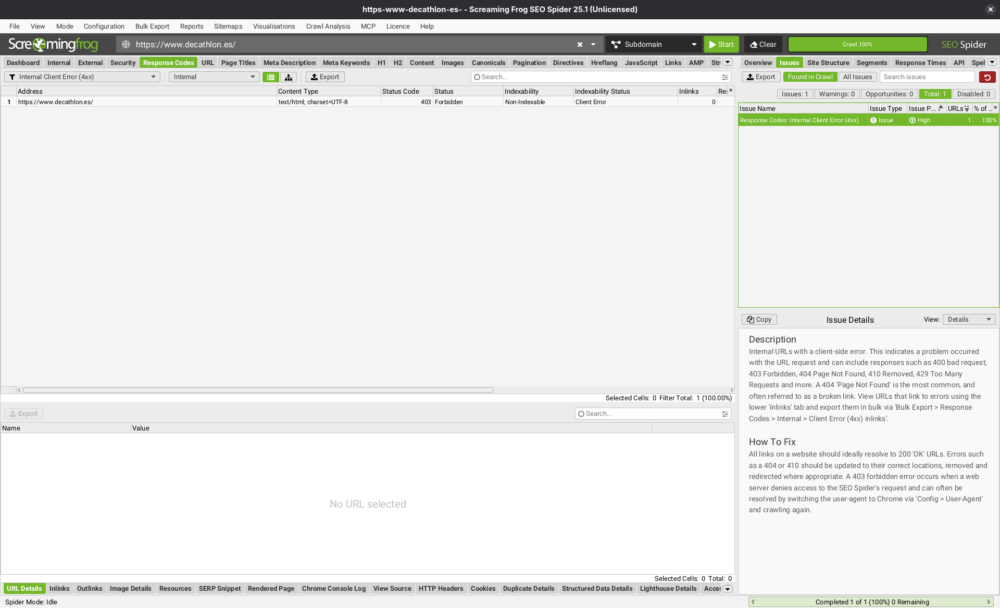
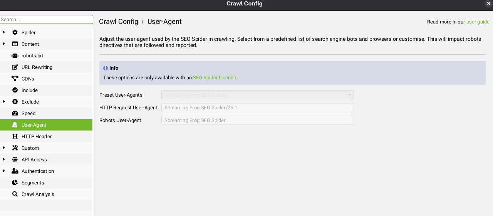



## Exercise 1

Sport+ has three parts that I would model separately: the membership itself, the points and the challenges. All of them hang from CLIENTE_REGISTRADO becuase only registred customers can join and from PEDIDO because purchases are what move the points and the progress of each challenge.

::: {.callout-note}
I keep the Spanish names of the existing entities as they appear in the figure from the module (CLIENTE_REGISTRADO, PEDIDO, LINEA_ENCARGO, PRODUCTO, TIPO_PRODUCTO and IDIOMA) and use English names for the new ones.
:::

### a) Entities and attributes

#### SPORTPLUS_MEMBER

SPORTPLUS_MEMBER (customer_id, enrollment_date, points_balance, active, leave_date)

Joining is voluntary so not every registered customer is a member. I could add these attributes directly to CLIENTE_REGISTRDO but they would stay empty for everyone who never joins. That is why I would model the member as a partial specialization of CLIENTE_REGISTRADO, the same idea the module uses to split CLIENTE into registered and unregistered customers [@alavedra2022]. `points_balance` could be calculated from the movements below but I would store it anyway so the customer area can show it without adding up the whole history. The module does the same with `cumulative_purchase_sum`. `active` and `leave_date` allow a logical delete like `dereg_customer` does.

#### POINTS_MOVEMENT

POINTS_MOVEMENT (movement_id, customer_id, order_id, movement_date, points, movement_type)

Every change in the balance is stored as a movement (points earned with an order, points redeemed for a voucher, points reversed when an order is cancelled or manual corrections). `points` is positive or negative depending on the type and `order_id` is only filled when the movement comes from a purchase. Keeping the history and not only the balance lets the customer see why they have the points they have. It is also the data the data warehouse would need later to analyse the program.

#### VOUCHER

VOUCHER (voucher_id, code, customer_id, amount, issue_date, expiry_date, origin, status, order_id)

Both ways of getting a dicount in Sport+ consist on the same thing in the end, a discount voucher. So I would use a single entity for both. `origin` says if the voucher comes from redeeming points or from a challenge, `status` can be available, used, expired or cancelled and `order_id` is the order where it was applied.

#### CHALLENGE

CHALLENGE (challenge_id, start_date, end_date, condition_type, target_value, duration_days, reward_amount, active)

Challenges can have different conditions so I would not hardcode them. `condition_type` says what is measured (different categories bought, number of orders, money spent...) and `target_value` how much is needed. For the example in the statement that would be distinct categories with a target of 3 and `duration_days` set to 60 with a `reward_amount` of 15. The name and the descripcion of each challenge are text shown on the website so following the module they do not go here but in a relationship with IDIOMA.

#### PARTICIPATION

PARTICIPATION (customer_id, challenge_id, join_date, deadline, progress, status, completion_date, voucher_id)

THis entity tracks which customers take part in each challenge and how far they are. I would make it an entity and not just an M-N relationship for the same reason the module gives for PEDIDO: it stores a lot of information of its own and other entities relate to it. `deadline` is the join date plus `duration_days` (never later than the end of the challenge) and `progress` is the current value of the condition, for instance 2 out of 3 categories. `status` can be in progress, completed or expired and `voucher_id` stays empty until the reward is granted.

### b) Relationships and cardinalities

| Relationship | Entities | Cardinality | Reason |
|---|---|---|---|
| Specialization | CLIENTE_REGISTRADO and SPORTPLUS_MEMBER | Partial | A registered customer may or may not join, a member is always a registered customer |
| HAS_MOVEMENT | SPORTPLUS_MEMBER and POINTS_MOVEMENT | 1-N | Each movement belongs to one member and a member acumulates many over time |
| GENERATES | PEDIDO and POINTS_MOVEMENT | 1-N (optional) | An order earns points and can reverse them if cancelled, redemptions have no order |
| OWNS | SPORTPLUS_MEMBER and VOUCHER | 1-N | A member can have several vouchers |
| APPLIED_TO | PEDIDO and VOUCHER | 1-N (optional) | A voucher is used in one order at most and an order can use several or none |
| TAKES_PART | SPORTPLUS_MEMBER and PARTICIPATION | 1-N | A member can join many challenges |
| OF | CHALLENGE and PARTICIPATION | 1-N | A challenge has many participants |
| REWARDS | PARTICIPATION and VOUCHER | 1-1 (optional) | Only completed participations get a voucher |
| COUNTS | CHALLENGE and TIPO_PRODUCTO | M-N (optional) | Categories that count for the challenge |
| DESC_CHALLENGE | CHALLENGE and IDIOMA | M-N | Name and description in each language like DESC_PROD |

The two relationships through PARTICIPATON are basically the M-N relationship between members and challenges split in two.

PRODUCTO is not linked directly to any new entity and it does not need to be. To know wich categories a customer bought the system can go from PEDIDO through LINEA_ENCARGO to PRODUCTO and from there through PERTENECER to TIPO_PRODUCTO, which allready exist. One detail to consider is that TIPO_PRODUCTO is a hierachy thanks to CLASIFICACION so "three different categories" needs a level. I would count the types linked in COUNTS and treat any of their subtypes as the same category. If not running shoes and running socks would count as two categroies when for the customer they are both "running". ALso a product can belong to several types (PERTENECER is M-N) so each product should only count once per challenge.

### c) Data manipulation operations

I use the same notation as the module with the operation name and its input parameters. All of them need parameters so I would implement them as stored procedures. The ones that run automatically are triggers and I describe them in section d).

| Operation | Type | Network |
|---|---|---|
| enroll_sportplus (customer_id) | Create a member with balance 0 | Public |
| leave_sportplus (customer_id) | Logical delete (`active`, `leave_date`) | Public / intranet |
| member_summary (customer_id) | Read balance, last movements and vouchers | Public |
| redeem_points (customer_id, points) | Create a negative movement and a voucher | Public |
| apply_voucher (code, order_id) | Update the voucher as used in the order | Public |
| adjust_points (customer_id, points, reason) | Create a manual movement | Intranet |
| expire_vouchers (date) | Update expired vouchers | Intranet |
| create_challenge (start_date, end_date, condition_type, target_value, duration_days, reward_amount) | Create | Intranet |
| list_challenge_desc (challenge_id, language_id, name, description) | Create the text in one language | Intranet |
| list_challenge_type / delist_challenge_type (challenge_id, product_type_id) | Create / delete a counted category | Intranet |
| modify_challenge (challenge_id, ...) | Update | Intranet |
| delist_challenge (challenge_id) | Delete or logical delete | Intranet |
| join_challenge (customer_id, challenge_id) | Create a participation | Public |
| leave_challenge (customer_id, challenge_id) | Delete the participation | Public |
| challenge_progress (customer_id, challenge_id, language_id) | Read progress and deadline | Public |

Some of them need extra care. `redeem_points` has to check the balance, insert the movement, create the voucher and update `points_balance` in a single transaction. Otherwise two simultaneus requests could spend the same points twice. `create_challenge` and `list_challenge_desc` go in the same transaction too (like `list_product_desc` and `list_product_attribute` in the module) since a challenge without a description in any language can not be shown. I would also only let `modify_challenge` change the conditions before `start_date`. Changing the target once customers are halfway would not be fair so after that only the dates or the texts could change. For the same reason `delist_challenge` only deletes the row if nobody joined and otherwise it just sets `active` to false.

### d) Integration with existing operations

I think confirming a purchase should update the points and the challenges automatically. If it depended on someone running a process the customer would not see the reward of their purchase right away, and seeing it is what makes them want to buy again. The module already uses triggers on the update of PEDIDO when the payment result is correct (`transaction_result_id = 0`) to update `date_last_purchase`, `cumulative_purchase_sum` and `number_purchases`. I would hook two new triggers to that same event:

- `earn_points (order_id)`: if the customer is an active member it inserts a movement with the points of the order and updates the balance. I would calculate the points over what the customer really paid after vouchers so nobody earns points with the discounts they got from points.
- `update_progress (order_id)`: for each participation of the custoemr that is still in progress it recalculates `progress` from all of their paid orders between `join_date` and `deadline`, not only from the new one. For "three different categories" one order is not enough and a category bought twice must only count once, so counting the distinct categories over the whole window solves both. If the progress reaches the target than it sets the participation as completed and creates the voucher.

The opposite case has to be covered as well. In the EU a customer has 14 days to withdraw from an online purchase [@eu2011], so when `order_status` moves an order to cancelled or returned another trigger `reverse_points (order_id)` would insert a negative movement and run the same recalculation, which now leaves the returned order out. If a challenge voucher was granted and is not used yet I would cancel it. If not the customer could buy three categories, get the €15 and return everything.

Some existing operations also need changes:

- `order_data` and the calculation of `order_total` have to subtract the vouchers applied with `apply_voucher`.
- `order_information` should also return the points earned and the vouchers used in the order.
- `dereg_customer` has to call `leave_sportplus` and cancel the available vouchers of the customer.
- `customer_discount` needs a rule for combining the customer type discount with vouchers. I would apply the type discount first and the voucher after.

Lastly the movements and participations should also feed the data warehouse. That way marketing can measure if Sport+ really increases sales, which is what the CRM section of the module is about.

### e) Query operations

#### challenge_summary (challenge_id, language_id)

For one challenge it returns its name in the given language, the number of participants, how many completed it and how many expired, the vouchers granted and how many of them were actually used in an order. It runs from the intranet and lets marketing decide if a challenge worked and should be repeated or if the target was too hard.

#### inactive_members (days, min_points)

It returns the active members with at least `min_points` that have not bought anything in the last `days` days using `date_last_purchase` from CLIENTE_REGISTRADO. The module itself mentions offering special conditions to customers who have not purchased in more than two months [@alavedra2022]. These customers are perfect for that because they have points they are not using, so the store could remind them of their balance or invite them to a challenge.

### f) Gamification

Yes, I consider Sport+ an example of gamification. Gamification is usually defined as the use of game design elements in non-game contexts [@deterding2011] and Sport+ uses several of them to make buying feel a bit like progressing in a game. These are the three elements I would highlight:

- **Points.** Every purchase gives immediate feedback in the form of a score that grows. Customers come back to keep accumulating and leaving for a competitor means losing the points they have, which works as a switching cost.
- **Challenges with a goal and a deadline.** They work like quests in a game. A concrete goal with a time limit creates urgency and the example in the statement pushes customers to buy in categories they maybe never bought in the store. So it increases both the number of orders and the variety of the basket.
- **Progress tracking.** Showing "2 out of 3 categories" uses the goal-gradient effect: people speed up their purchases the closer they are to a reward, as Kivetz et al. showed with coffee loyalty cards [@kivetz2006]. A customer at 2 out of 3 is very likely to make the third purchase before the deadline.

The risk is that all three are extrinsic rewards. If challenges are too generous Sport+ can end up training customers to only buy with a voucher, so the queries from section e) are neccesary to check that the program brings sales and not only discounts.



## Exercise 2

### a) Structured data in e-commerce

Structured data is a way of describing what a page contains in a standard format that machines can read. This way a search engine does not have to guess from the HTML that a number is a price or that 4.6 is the average rating. IN practice it is the schema.org vocabulary written as JSON-LD inside the page, which is the format google recommends [@google_sd_intro].

For an online store the benefit is mostly visibility. With the markup a product can appear as a rich result with its price, stock and rating stars right in the search results and it can also show up in Google's merchant listings [@google_merchant]. Google does not present structured data as a ranking factor and its own case studies talk about click-through rate and not about position [@google_sd_intro]. So it does not move the page up but a result with price and stars gets more clicks than a plain blue link in the same position.It also avoids surprises for the customer as they see the price and availability before entering the store.

Here is an example for a product of the sports store from Exercise 1:

```json
{
  "@context": "https://schema.org",
  "@type": "Product",
  "name": "Trail running shoes TR-500",
  "image": "https://example-sports.com/img/tr-500.jpg",
  "brand": { "@type": "Brand", "name": "Trailrun" },
  "aggregateRating": {
    "@type": "AggregateRating", "ratingValue": 4.6, "reviewCount": 212
  },
  "offers": {
    "@type": "Offer",
    "price": 89.99,
    "priceCurrency": "EUR",
    "availability": "https://schema.org/InStock",
    "hasMerchantReturnPolicy": {
      "@type": "MerchantReturnPolicy",
      "applicableCountry": "ES",
      "returnPolicyCategory": "https://schema.org/MerchantReturnFiniteReturnWindow",
      "merchantReturnDays": 30,
      "returnFees": "https://schema.org/FreeReturn"
    }
  }
}
```

These are the five properties I consider most relevant [@schema_product]:

1. **`price` and `priceCurrency`** (inside `offers`): the price and its ISO 4217 currency. Together with the name and the image they are what Google requires for a merchant listing [@google_merchant] and price is usually the first thing a shopper compares.
1. **`availability`**: if the product is in stock, out of stock, on preorder, etc. Showing "In stock" in the results avoids clicks from people who will leave as soon as they see the product is not available. I would take it from `current_stock` in the database so it is never outdated.
1. **`brand`**: the brand of the product. In sports equipment many searches include the brand ("Asics running shoes") so it helps to match those searches. It is also how customers filter in shopping results.
1. **`aggregateRating`**: the average rating and the number of reviews. THe stars in the results are probably the element that gets the most attention and they work as social proof.
1. **`hasMerchantReturnPolicy`**: the return conditions (days, country and if returns are free). They are a real factor when deciding where to buy online. Google now also accepts this policy once at the Organization level for the whole store [@google_org] so a store with one policy for everything does not need to repeat it in every product becasue it applies to all of them.



### b) Generative artificial intelligence and SEO

With 20,000 products writing every description by hand is not realistic so I understand why the store considers it. I think AI is a good tool for this but only if it works from the store's own product data and somebody checks the results before they go live.

I see two clear benefits. The first one is scale. The whole catalogue (and every new collection) can be covered in days instead of months. A store this size probably has many pages with no description at all or with the manufacurer's text copied as is. The second one is langauges. The same data can produce descriptions in every language the store sells in, which fits the model of Exercise 1 where every description is stored per language in IDIOMA.

There are also two risks. The first one is hallucinations. A model does not look up facts, it predicts a likely sequence of words [@google_genai]. So it can invent a weight, a size or a material. In a running shoe that means returns, complaints and misleading information for the consumer. The second one is generic text. If competitors use the same models with the same manufacturer data the 20,000 pages will say the same as everyone else. Google calls generating many pages that give little value to users "scaled content abuse" and says it applies "no matter how it's created" [@google_spam].

Regarding quality and ranking Google judges content by how useful it is, whatever tool was used to write it [@google_genai]. Compared with empty pages the quality would probably improve and that alone can bring long tail traffic. But uniqueness goes down. Generic descriptions add nothing the manufacturer page does not have (no experience with the product, no comparisons, no answers to real questions) and that is what makes a store rank above its competitors for the important searches. I would expect some gains in the long tail and no gains where it realy matters.

Because of all this I would not publish it without review. Google itself says it is critical to manually fact-check all AI-generated content before publishing [@google_genai] and Merchant Center asks for AI-generated product descriptions to be labelled as such. Reviewing 20,000 texts one by one defeats the purpose though, because is the same work the store wanted to avoid. So the review has to depend ont he risk of each product.

To use AI while keeping these risks low I would take two measures. First I would generate only from the store's own product data (materials, sizes, weight, use) with instructions not to add anything outside of it, plus an automatic check that compares the numbers in the text with the database. Any text that fails goes to manual review. Second I would fully review the products that bring the most traffic and sales and enrich them with what an AI can not write (own tests, photos, customer reviews and questions) while the rest are reviewed by sampling. I would roll it out in batches and compare clicks in Search Console against a control group before doing the whole catalogue.



### c) SEO analysis using Screaming Frog

I crawled <https://www.sprintersports.com/> (sprinter.es redirects there with a 301) using the free version of Screaming Frog SEO Spider 25.1. This version stops at 500 URLs. It found 41 types of problems: 6 issues, 16 warnings and 19 opportunities (see @fig-sf-issues).

{#fig-sf-issues width=100%}

::: {.callout-warning}
My first choice was decathlon.es but its server answered the crawler with a 403 Forbidden on the very first request (see @fig-decathlon-403). Changing the user agent to a browser one needs a licence (see @fig-useragent) so I moved to Sprinter, wich is also a sports store like the one in Exercise 1.
:::

The warnings with the most URLs are missing security headers and incomplete social tags (X-Frame-Options, Content-Security-Policy, Open Graph...). They affect between 80% and 100% of the pages but Screaming Frog rates them Low and they do not change how Google indexes the store. I focused on these three instead.

#### 1. Main category pages over 2MB of HTML

Four pages are over 2MB of HTML: `/ofertas`, `/equipacion-deportiva`, `/moda-deportiva-hombre` and `/moda-deportiva-mujer`. Googlebot only crawls the first 2MB of an HTML file (uncompressed) and ignores the rest for indexing [@google_googlebot]. For comparison the median HTML page is around 30 kB. And these four are the main hubs of the store, including the offers page a few weeks before Black Friday. Whatever comes after the limit (products further down, links to subcategories, the footer) may never be seen by Google.

To fix it I would first check what makes them so heavy. On a listing page it is usually the whole product grid plus inline scripts or data for every product. I would limit the first page to a fixed number of products (for instance 48) and use the paginaton the site already has (the crawl found `?page=2` URLs). Inline scripts and data should move to external files. After that I would crawl again to confirm the four pages are below 2MB.

#### 2. Categories with noindex linked from the main menu

There are 33 URLs with `noindex` and 26 of them are also `nofollow`. Of these, 22 are linked from the menu of all 305 HTML pages crawled. That makes around 6,700 navigation links to pages Google is told not to index. Some make sense like legal pages or temporay promotions (`/promo-camisetas-19-99`). But others are evergren categories that people search for every day: `/outlet`, `/ultimas-unidades`, `/banadores-bikinis-ninas`, `/tops-fitness-de-mujer` and `/bh-maquinas-de-gimnasio`.

These categories can not rank at all so searches like "outlet deportivo" or "bikinis niña" go to competitors. Also with `nofollow` Google does not follow the links to the products inside them. So the store sends link equity from every page into pages that can not rank and do not pass it on to the products.

I would review the list with marketing. Evergreen categories should drop both `noindex` and `nofollow`. Temporary promotions can keep `noindex` but with `follow` so Google still reaches the products and they should leave the global menu (or redirect with a 301 to the parent category) once the campaign ends.

#### 3. Oversized images

86 of the 143 images crawled (60%) are over 100 kB. All of them are JPEG and 1,504 pixels wide with a median of 1.2 MB and a maximum of 3.2 MB. The heavyest ones are the pre-Black Friday banners of the homepage, which alone references 78 of these images: about 50 MB in desktop versions and 46 MB in mobile versions.

Page speed affects both users and ranking since Google uses Core Web Vitals in its ranking systems [@google_cwv]. A 3 MB banner at the top of the page hurts the Largest Contentful Paint on mobile and that happens when Black Friday brings the most traffic. However Screaming Frog downloads the image URL as is and the CDN of Sprinter could be serving WebP or AVIF to real browsers. So I would confirm the real weight with PageSpeed Insights before anything else.

The fix would be to compress the images, serve them in WebP or AVIF and resize them to the width they are actually shown at with `srcset`. 1,504 pixels is far too much for a phone. Banners below the first screen should use lazy loading and only the first one should be preloaded. A reasonable target would be under 200 kB per banner.

All in all the three issues affect the most important pages of the store (the homepage, the offers and the main categories), so with Black Friday coming I would start with them.



## Annexes {.unnumbered}

::: {#fig-decathlon layout-ncol=2}

{#fig-decathlon-403}

{#fig-useragent}

First crawl attempt on decathlon.es
:::



## References

::: {#refs}
:::
